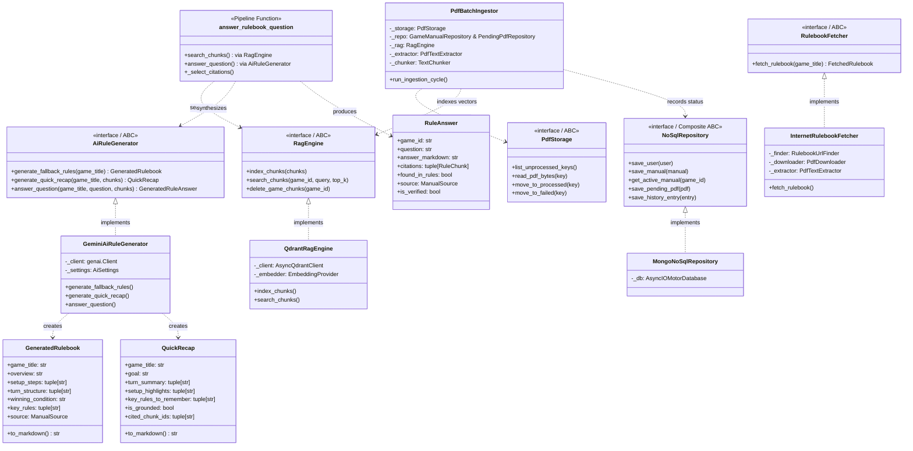
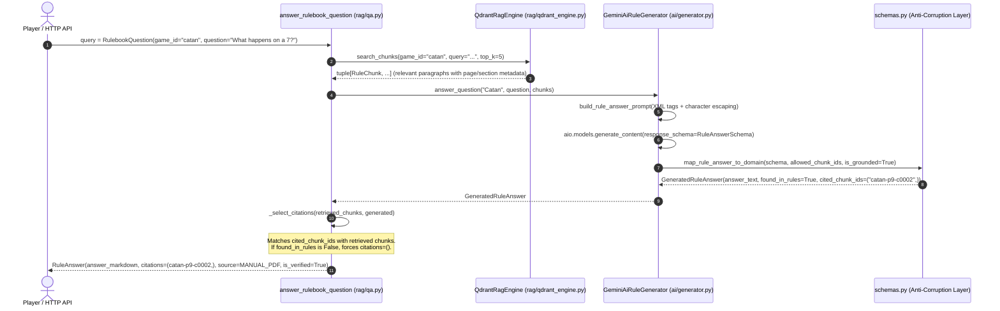
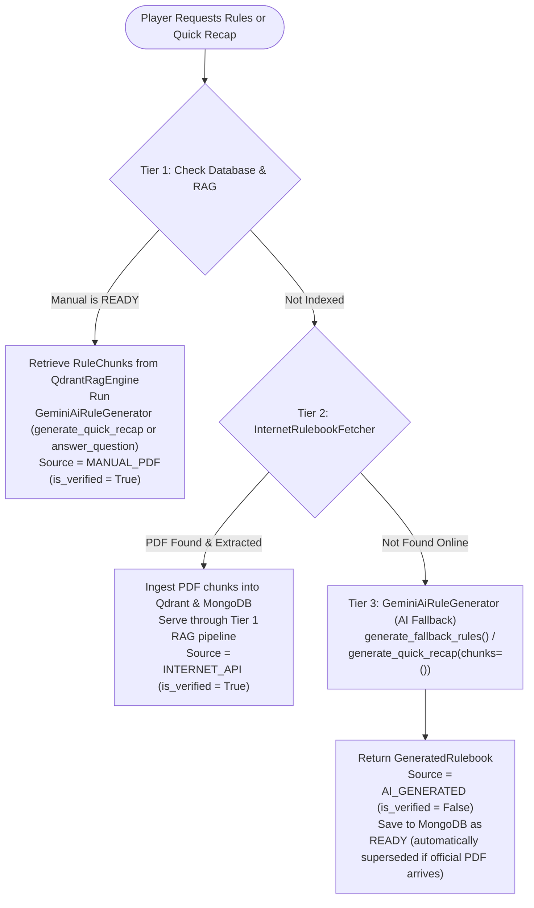
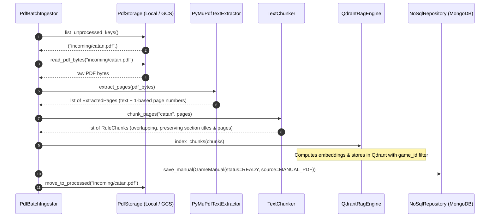

# System Class Interactions & Architecture

This document visualizes the current architectural structure of **BoardGameRules** following Task 7, explaining how domain entities, abstract ports (ABCs), infrastructure adapters, and application pipelines interact.

---

## 1. Class & Contract Architecture Diagram

The system adheres to **Hexagonal Architecture (Ports and Adapters)**. High-level workflows depend only on abstract domain ports (`contracts.py`), while concrete adapters (`MongoNoSqlRepository`, `QdrantRagEngine`, `InternetRulebookFetcher`, `GeminiAiRuleGenerator`) implement those contracts.

---

## 2. Core Interaction Workflows

### 2.1 Grounded RAG Question-Answering Pipeline (`rag/qa.py`)

When a player asks a rule question, `answer_rulebook_question` acts as a pure pipeline function coordinating vector retrieval and LLM synthesis with anti-corruption mapping:

---

### 2.2 Three-Tier Rule Resolution Chain (Tasks 4, 6, 7 → Task 8)

The system is designed around a 3-tier fallback hierarchy that **Task 8 (Rule Orchestrator)** coordinates:

---

### 2.3 Batch PDF Ingestion Pipeline (`batch/ingestor.py`)

When official PDFs are dropped into storage, `PdfBatchIngestor` processes them in a single batch cycle:

---

## 3. Key Architectural Patterns in Use

| Concept Tag | Location | Plain-English Purpose |
|:---|:---|:---|
| **`[Design Pattern] Explicit Abstract Base Class (ABC) Ports`** | [`domain/contracts.py`](../src/boardgamerules/domain/contracts.py) | Outer infrastructure tools (databases, vector stores, LLMs, storage) depend on inner domain ABCs, allowing all I/O to be substituted with fast in-memory fakes in tests. |
| **`[Design Pattern] Anti-Corruption Layer`** | [`ai/schemas.py`](../src/boardgamerules/ai/schemas.py) | Uses Pydantic v2 schemas to parse untrusted JSON from Gemini, sanitizing whitespace and filtering hallucinated citation IDs before mapping to frozen domain entities. |
| **`[AI Engineering] Prompt Injection Defense`** | [`ai/prompts.py`](../src/boardgamerules/ai/prompts.py) | Isolates untrusted queries and PDF excerpts inside XML tags (`<rulebook_excerpts>`), stripping control chars and escaping XML delimiters to protect system instructions. |
| **`[AI Engineering] Structured LLM Outputs`** | [`ai/generator.py`](../src/boardgamerules/ai/generator.py) | Constrains Gemini output directly via `response_schema` and `response_mime_type="application/json"` instead of fragile regex parsing of markdown text. |
| **`[System Design] SSRF Protection`** | [`fetcher/url_safety.py`](../src/boardgamerules/fetcher/url_safety.py) | Asynchronously resolves hostnames and blocks private, loopback, link-local, and cloud metadata IPs before fetching external PDFs. |
| **`[Design Pattern] Immutable State Machine Transition`** | [`domain/manual.py`](../src/boardgamerules/domain/manual.py) | Entities like `GameManual` use frozen dataclasses and return new instances (`replace()`) upon state changes (e.g. `mark_superseded()`), preventing hidden mutation bugs. |
