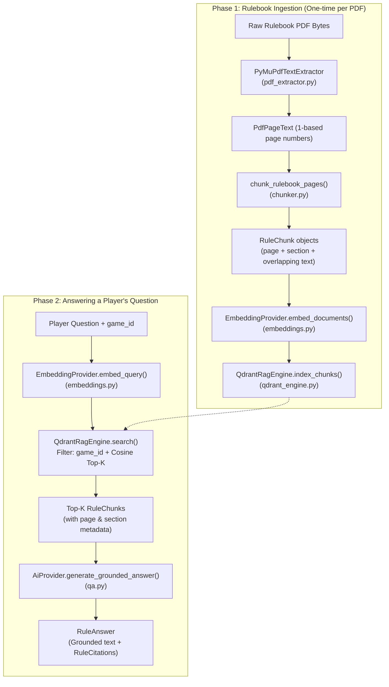

# How RAG Works in BoardGameRules

## 1. What is RAG (Retrieval-Augmented Generation)?

When a player asks an AI a specific board game rule question—for example, *"In Catan, can I build a settlement on an intersection between another player's two road segments?"*—relying on a standard Large Language Model (LLM) alone has two major problems:

1. **Hallucinations**: LLMs predict plausible-sounding words rather than looking up facts. They frequently mix up official rules with house rules, older editions, or similar games.
2. **No Page Citations**: Even if the LLM guesses the right answer, players at a table need to know **which page and section** of the official rulebook proves it.

**Retrieval-Augmented Generation (RAG)** solves both problems by turning the question into an **open-book exam** instead of a memory test:

1. **Retrieve**: Before asking the LLM to answer, the system searches the official PDF rulebook for the exact paragraphs most relevant to the player's question.
2. **Augment**: Those retrieved rulebook excerpts (along with their page numbers and section headings) are handed to the LLM as its **only allowed source of truth**.
3. **Generate**: The LLM writes a grounded answer based strictly on those excerpts and attaches verifiable page and section citations.

---

## 2. Why Do We Need Embeddings and a Vector Store?

Traditional keyword search (`Ctrl+F`) only matches exact words. If a player asks:
> *"What happens when the draw pile runs out?"*

and the rulebook says:
> *"If the deck is exhausted, shuffle the discard pile to form a new supply."*

keyword search fails because `"draw pile runs out"` and `"deck is exhausted"` share zero words.

### Vector Embeddings (Meaning as Coordinates)
Think of a standard map with 2 coordinates: `(Latitude, Longitude)`. Two cities with similar coordinates are physically close together.

An **embedding model** (in our app, Google's `text-embedding-004` called via `GeminiEmbeddingProvider` in [`embeddings.py`](../src/boardgamerules/rag/embeddings.py)) does the same thing for **meaning**, except instead of 2 coordinates, it uses **768 coordinates** (a list of 768 floating-point numbers between `-1.0` and `1.0`).

1. **How the Model Learned Meaning**:
   - Google trained `text-embedding-004` on billions of question-and-answer pairs, articles, and manuals using *contrastive learning*.
   - During training, whenever two sentences meant the same thing (like *"out of cards"* and *"deck is exhausted"*), the neural network adjusted its weights to push their 768 numbers closer together. Whenever two sentences were unrelated, it pushed their numbers further apart.
   - Each dimension doesn't represent one single English word; instead, combinations of dimensions capture abstract concepts (e.g., *"card decks / shuffling"*, *"turn order"*, *"victory conditions / scoring"*, *"dice combat"*).

2. **Concrete Example (Simplified to 3 Dimensions)**:
   Suppose the embedding model only output 3 numbers roughly corresponding to `[Card/Deck Concept, Dice/Combat Concept, Scoring Concept]`:

   | Text Sent to Embedding API | Returned Vector (Coordinates) |
   | :--- | :--- |
   | **Chunk A**: *"If the deck is exhausted, shuffle the discard pile."* | `[ 0.92,  0.05, -0.10]` |
   | **Chunk B**: *"Roll two six-sided dice to resolve combat damage."* | `[ 0.04,  0.95,  0.02]` |
   | **Chunk C**: *"The player with the most victory points wins."* | `[-0.08,  0.01,  0.96]` |
   | **Player Question**: *"What happens when the draw pile runs out?"* | `[ 0.89,  0.08, -0.12]` |

   Notice that the **Player Question** `[0.89, 0.08, -0.12]` has almost the exact same coordinates as **Chunk A** `[0.92, 0.05, -0.10]`, even though they share zero keywords!

3. **Asymmetric Task Types (`RETRIEVAL_DOCUMENT` vs `RETRIEVAL_QUERY`)**:
   - A player's question is short and interrogative (*"How do I get more cards?"*), whereas a rulebook chunk is a declarative rule (*"At the end of your turn, draw 2 cards from the supply."*).
   - In [`embeddings.py`](../src/boardgamerules/rag/embeddings.py#L62-L81), `embed_documents()` sends `task_type="RETRIEVAL_DOCUMENT"` when indexing rulebook chunks, and `embed_query()` sends `task_type="RETRIEVAL_QUERY"` when embedding a player's question. This tells Gemini's embedding neural network: *"Map this question to the same coordinate neighborhood where its answer document lives."*

### Vector Store (Qdrant) & Cosine Similarity
Important distinction: **The Embedding API creates the coordinates, and Qdrant stores and searches them.**

1. **Indexing (`QdrantRagEngine.index_chunks`)**:
   - First, `QdrantRagEngine` calls `self._embedder.embed_documents(...)` to get a 768-float vector for each `RuleChunk`.
   - Next, it saves each vector into Qdrant as a `PointStruct(id=..., vector=[...], payload={"game_id": "catan", "page_number": 4, "text": "..."})`.
   - Inside Qdrant, vectors are organized into an **HNSW (Hierarchical Navigable Small World) graph**—a spatial index that links nearby vectors together like highways and local streets so Qdrant doesn't have to scan millions of unrelated chunks one by one.

2. **Searching (`QdrantRagEngine.search_chunks`)**:
   - When a user asks a question, `QdrantRagEngine` first calls `self._embedder.embed_query(query)` to get the question's 768-float vector.
   - It then asks Qdrant (`query_points`) to:
     1. **Filter first**: Only look at points where `payload.game_id == "catan"`.
     2. **Measure angle closeness (Cosine Similarity)**: Compare the question vector $\vec{q}$ against the candidate chunk vectors $\vec{d}$ using the dot product of normalized vectors:
        $$\text{Cosine Similarity}(\vec{q}, \vec{d}) = \frac{\vec{q} \cdot \vec{d}}{\|\vec{q}\| \|\vec{d}\|}$$
        - **`1.0`** = Vectors point in the exact same direction (identical meaning).
        - **`0.0`** = Vectors are perpendicular (unrelated meaning).
     3. **Return Top-$K$**: Return the 5 chunks with the highest similarity scores, along with their stored `page_number`, `section_title`, and `text`.

---

## 3. End-to-End Pipeline in BoardGameRules

Our RAG module lives in [`src/boardgamerules/rag/`](../src/boardgamerules/rag/) and operates in two phases: **Ingestion** (when a PDF rulebook is added) and **Question Answering** (when a user asks a rule question).



### Step-by-Step Breakdown

1. **PDF Text Extraction ([`pdf_extractor.py`](../src/boardgamerules/rag/pdf_extractor.py))**
   - `PyMuPdfTextExtractor` reads raw PDF bytes in memory using PyMuPDF (`fitz`).
   - Enforces safety limits (`max_pdf_bytes = 50 MB`, `max_pages = 500`) to prevent corrupted or oversized PDFs from exhausting memory.
   - Preserves **1-based page numbers** and detects bold/larger-font lines on the PDF page, prefixing them with `# Heading` so section structure isn't lost.

2. **Section-Aware Overlapping Chunking ([`chunker.py`](../src/boardgamerules/rag/chunker.py))**
   - If you slice a PDF strictly every 800 characters, you cut rules in half and forget which heading they belonged to (e.g., whether a rule is under *"Setup"* or *"End of Game"*).
   - `chunk_rulebook_pages()` tracks the active section title across paragraphs and pages, splits on natural paragraph/word boundaries, and keeps an **overlap window** (`overlap_chars=150`) between long slices so context at chunk boundaries is preserved.
   - Produces immutable `RuleChunk` domain objects with deterministic IDs (`{game_id}-p{page}-c{index}`).

3. **Vector Indexing & Search ([`qdrant_engine.py`](../src/boardgamerules/rag/qdrant_engine.py))**
   - `QdrantRagEngine` converts each deterministic `(game_id, chunk_id)` into a UUIDv5 point ID. Re-indexing the same rulebook **overwrites** existing points idempotently instead of creating duplicate chunks.
   - `search()` embeds the player's question and queries Qdrant with a mandatory `FieldCondition(key="game_id", match=MatchValue(value=game_id))` filter.

4. **Grounded Question Answering ([`qa.py`](../src/boardgamerules/rag/qa.py))**
   - `answer_rulebook_question()` takes a `RulebookQuestion` value object and orchestrates retrieval (`QdrantRagEngine.search_chunks`) and generation (`AiProvider.generate_grounded_answer`).
   - If Qdrant returns zero chunks for a game, it raises `ManualNotFoundError` immediately—enabling our caller to trigger the AI Fallback pipeline (and mark the answer with a fallback warning) rather than letting the LLM guess silently.

---

## 4. Why In-Memory Mode (`:memory:`) Exists & Why One `QdrantRagEngine` Works Everywhere

Why do we need an in-memory mode at all? It serves **two practical purposes**:

1. **Fast, Offline Automated Testing & GitHub Actions CI**:
   - Unit tests (`pytest`) and GitHub Actions CI run in clean environments with **no internet access, no live database servers, and no cloud API keys**.
   - Using `:memory:` lets all 75 tests run in **~0.5 seconds** on every `git push` without spinning up Docker containers or paying for cloud calls.
   - When testing higher-level services later (like the Batch PDF Ingestion Job or the Rule Orchestrator), we can wire up the real `QdrantRagEngine` in `:memory:` mode instead of writing brittle mock objects.
2. **Zero-Config Local Development ("Clone & Run")**:
   - When developing the FastAPI backend or React UI locally on your machine, you don't always want to connect to production MongoDB Atlas or Qdrant Cloud clusters.
   - Passing `AsyncQdrantClient(location=":memory:")` (or `AsyncQdrantClient(path="./.local_qdrant")` to persist on local disk) lets the entire app run locally out of the box with zero cloud setup.

### Why We Only Needed One `QdrantRagEngine` Class
In many databases (like MongoDB), the official driver cannot run without a real MongoDB server process, which is why we created `InMemoryNoSqlRepository` alongside `MongoNoSqlRepository` in [`src/boardgamerules/db/`](../src/boardgamerules/db/).

For **Qdrant**, `qdrant-client` includes a built-in embedded local engine:

- **In Unit Tests & Local Dev**: We pass `AsyncQdrantClient(location=":memory:")` into `QdrantRagEngine`.
- **In Production (GCP Cloud Run)**: We pass `AsyncQdrantClient(url="...", api_key="...")` into the **exact same** `QdrantRagEngine` class.

This means we don't need to maintain two separate RAG Engine classes—our fast unit tests verify the **real** Qdrant filter conditions, UUIDv5 point upserts, and Cosine similarity scoring with zero network calls.

---

## 5. How the Model is Imported and Wired in Code

The `text-embedding-004` model is **not** downloaded onto your computer as a multi-gigabyte weight file (which would bloat our Docker container and require a GPU). Instead, it runs on Google's servers and is called over HTTPS via the lightweight **`google-genai`** SDK (`from google import genai`), which is already installed in [`pyproject.toml`](../pyproject.toml).

### A. Production Setup (Driven by Environment Variables via `RagSettings`)

```python
from google import genai

from boardgamerules.rag import (
    GeminiEmbeddingProvider,
    PyMuPdfTextExtractor,
    QdrantRagEngine,
    RagSettings,
    chunk_rulebook_pages,
    create_qdrant_client_from_settings,
)

# 1. Load environment variables (GEMINI_API_KEY, QDRANT_URL, QDRANT_API_KEY, etc.)
settings = RagSettings.from_env()

# 2. Create the Google GenAI client and wrap it in our EmbeddingProvider
genai_client = genai.Client(api_key=settings.gemini_api_key)
embedder = GeminiEmbeddingProvider(
    client=genai_client,
    model=settings.gemini_embedding_model,  # Default: "text-embedding-004" (768 dims)
)

# 3. Connect Qdrant (:memory: or Qdrant Cloud) and initialize QdrantRagEngine
qdrant_client = create_qdrant_client_from_settings(settings)
rag_engine = QdrantRagEngine(
    client=qdrant_client,
    embedder=embedder,
    collection_name=settings.qdrant_collection_name,
    vector_size=settings.qdrant_vector_size,
)

# 4. Ingest a PDF rulebook
extractor = PyMuPdfTextExtractor()
pages = extractor.extract_pages(pdf_bytes)
chunks = chunk_rulebook_pages(game_id="catan", pages=pages)
await rag_engine.index_chunks(chunks)

# 5. Search or answer a player's question
top_chunks = await rag_engine.search_chunks(
    game_id="catan",
    query="What happens when a 7 is rolled?",
    top_k=5,
)
```

### B. Unit Test / Offline Setup (Zero Network Calls, Zero API Keys)

```python
from qdrant_client import AsyncQdrantClient

from boardgamerules.rag import DeterministicEmbeddingProvider, QdrantRagEngine

# Uses in-memory Qdrant + local SHA-256 token hashing (no API key or internet needed)
qdrant_client = AsyncQdrantClient(location=":memory:")
rag_engine = QdrantRagEngine(
    client=qdrant_client,
    embedder=DeterministicEmbeddingProvider(vector_size=32),
    vector_size=32,
)
```

---

## 6. Integration Configuration & Cost Breakdown

### A. Required Environment Variables & Local Docker Setup

By default, [`.env`](../.env) and [`RagSettings`](../src/boardgamerules/rag/config.py) are configured to connect to **local Qdrant running in Docker** (`http://localhost:6333`):

```bash
# Start local Qdrant (and MongoDB) in Docker:
docker compose up -d qdrant

# Open the Qdrant Web UI Dashboard in your browser to inspect chunks & vectors:
# http://localhost:6333/dashboard
```

| Environment Variable | Default Value | Purpose |
| :--- | :--- | :--- |
| `GEMINI_API_KEY` | *(set in `.env`)* | Authenticates `genai.Client(api_key=...)` for both `text-embedding-004` embeddings and Gemini text generation ([Google AI Studio](https://aistudio.google.com/apikey)). |
| `QDRANT_URL` | `http://localhost:6333` | Endpoint URL for `AsyncQdrantClient` (`http://localhost:6333` for local Docker, `:memory:` for unit tests, or your [Qdrant Cloud](https://cloud.qdrant.io/) URL). |
| `QDRANT_API_KEY` | `""` *(empty for local Docker)* | API key for Qdrant Cloud cluster (leave empty for local Docker or `:memory:`). |

#### Tunable Module Parameters (with sensible defaults already configured)
- **`GeminiEmbeddingProvider`** ([`embeddings.py`](../src/boardgamerules/rag/embeddings.py)):
  - `model_name="text-embedding-004"` (outputs `768`-dimensional vectors)
  - `batch_size=100` (embeds up to 100 chunks per HTTP call—Google AI Studio's max batch size per request)
- **`QdrantRagEngine`** ([`qdrant_engine.py`](../src/boardgamerules/rag/qdrant_engine.py)):
  - `collection_name="rulebook_chunks"`
  - `vector_size=768` (must match the embedding model's output dimension)
- **`ChunkingConfig`** ([`chunker.py`](../src/boardgamerules/rag/chunker.py)):
  - `max_chunk_chars=800` (~150–200 tokens per chunk)
  - `overlap_chars=150`
- **`PyMuPdfTextExtractor`** ([`pdf_extractor.py`](../src/boardgamerules/rag/pdf_extractor.py)):
  - `max_pdf_bytes=52_428_800` (50 MB)
  - `max_pages=500`

---

### B. Cost Breakdown (Free Tier vs. Paid Tier)

Both **Google Gemini Embeddings** and **Qdrant Cloud** are extremely cheap—and for a personal/portfolio project, **100% free**:

#### 1. Google Gemini Embedding API (`text-embedding-004`)
- **Google AI Studio Free Tier**: **$0.00 (Free)** up to **1,500 requests per minute (RPM)**.
  - Because `GeminiEmbeddingProvider` batches **100 chunks per request**, 1 request can embed an entire 30-page board game rulebook!
- **Paid Tier (Google AI Studio / Vertex AI)**: **~$0.000025 per 1,000 characters** ($0.025 per 1 million tokens).
  - **Indexing 1 typical board game manual** (~20 pages $\approx$ 40,000 characters $\approx$ 60 chunks): costs **$0.001** (one-tenth of a cent—so **1,000 full board game manuals cost ~$1.00** total, and you only embed each manual once when it is uploaded!).
  - **Answering 1,000 user questions** (embedding 1 short question per search): costs **<$0.002** (two-tenths of a cent).

#### 2. Qdrant Vector Database
- **Local / Dev / Tests (`location=":memory:"` or local file path `path="./qdrant_data"`)**: **$0.00 (Free)**, runs directly inside the Python process with zero external servers.
- **Qdrant Cloud Free Tier**: **$0.00/month forever** for a **1 GB RAM cluster** (no credit card required).
  - How much fits in 1 GB of Qdrant? Roughly **~200,000 to 300,000 chunks** of 768 dimensions—enough to store **3,000 to 5,000 complete board game rulebooks** for free.
